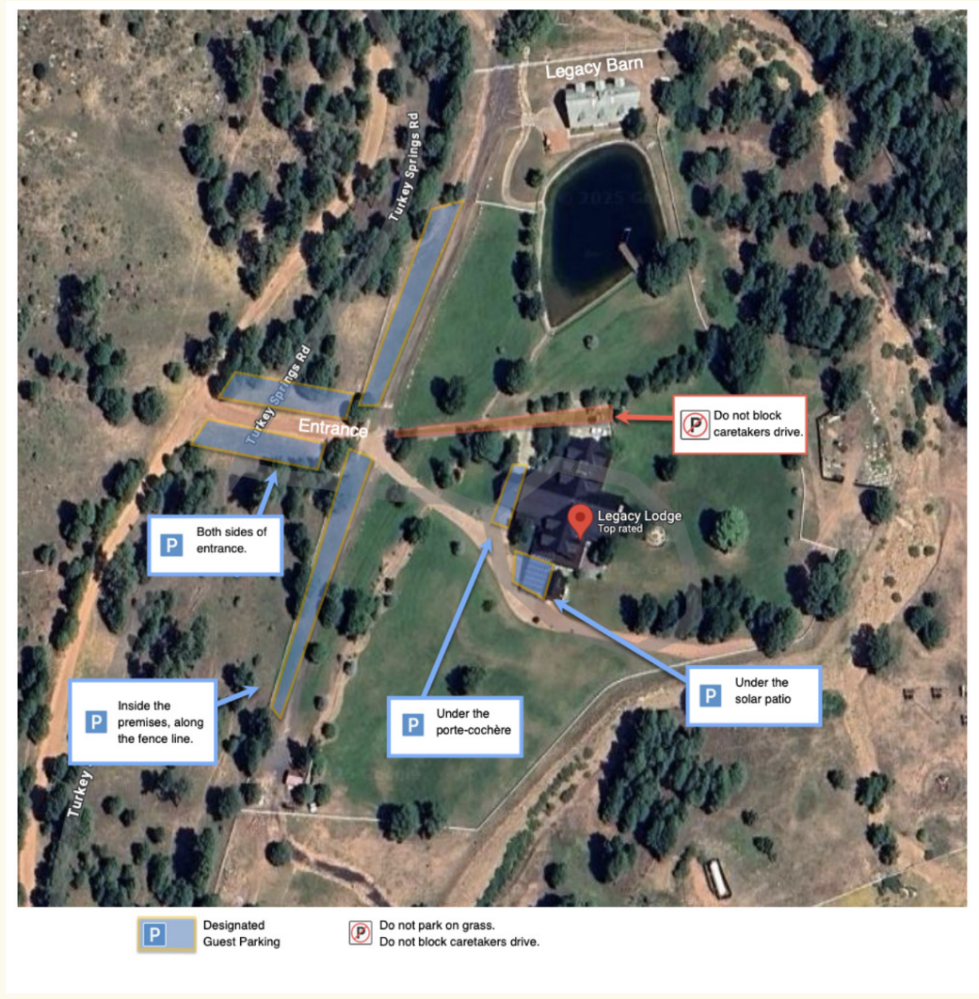

## Getting here

**The Legacy Lodge is a 2 1/2 hour drive from both [Phoenix Sky Harbor](https://www.skyharbor.com){target="_blank"} and [Flagstaff Pulliam Airport](https://flyflagstaffaz.com/){target="_blank"}.**

**The last stretch is a dirt access road.** Take it slow and enjoy the scenery. Cell service can be spotty in the mountains. Before you leave Phoenix, please [download your directions](https://www.google.com/maps/place/Legacy+Lodge/@34.3336143,-110.6564274,17.99z/data=!4m9!3m8!1s0x872ec650dbe91d65:0xb85604da7e5512fb!5m2!4m1!1i2!8m2!3d34.3330887!4d-110.6551981!16s%2Fg%2F1vl9rzbf?entry=ttu&g_ep=EgoyMDI2MDkzMC4wIKXMDSoASAFQAw%3D%3D){target="_blank"} as you may lose service on your way in.

::: {.pine-divider}
:::

## Where to park

**Park here**

- Outside the gate, without blocking the road or entrance
- Inside the gate, along the outer fence

**Please do not**

- Park on the grass
- Park on or block the caretaker's drive, marked in red on the map
- Connect RVs to the lodge. This is strictly prohibited.

Parking and no parking signs are posted throughout the property.

{fig-alt="Aerial map of the Legacy Lodge property with designated guest parking areas highlighted in blue" width=100%}

::: {.pine-divider}
:::

## Looking for somewhere to stay?

We've put together a few recommendations nearby:

- **[WorldMark Bison Ranch](https://www.wyndhamhotels.com/en-ca/wyndham-vacations/overgaard-arizona/worldmark-bison-ranch/overview){target="_blank"}** — ~28 minutes from the lodge.
- **[Rusty Buck Inn](https://www.rustybuckinn.com/?gad_campaignid=21499635766&gbraid=0AAAAAqSdy2IcvEc0PqUhsmC2wjEMDPsym){target="_blank"}** — ~22 minutes.
- **[Best Western Sawmill Inn](https://www.bestwestern.com/it_IT/book/hotels-in-heber/best-western-sawmill-inn/propertyCode.03123.html){target="_blank"}** — ~22 minutes.
- [AirBnB](https://www.airbnb.com/heber-overgaard-az/stays){target="_blank"} and [VRBO](https://www.vrbo.com/search?gad_campaignid=12239497913&gbraid=0AAAAACTxZ9ZoVWc_9GVBkAFasuW_0ktvO&destination=Heber,+Arizona,+United+States+of+America&regionId=113985&sort=RECOMMENDED&semcid=VRBO-US.UB.GOOGLE.DT-c-EN.VR&semdtl=a112239497913.b1132555443953.g1kwd-357534317279.e1c.m1Cj0KCQjw8ofWBhCHARIsANBj4Lu_LRxk_kK1nYWn-n0ObxHr_d-RueBlF3244t08Z1PKdKzTX170z9EaAra8EALw_wcB.r1789f2484aa3d92b64a6f11980f980066b7e1ac62f13d511ca1d700067927a3a5.c1.j19013184.k1.d1723392487768.h1e.i1.l1.n1.o1.p1.q1.s1heber+rentals+with+amenities.t1.x1.f1.u1.v1.w1){target="_blank"} also have a wide variety of nearby homes and cabins available for rent in the Heber-Overgaard area.

::: {.pine-divider}
:::

## The weather

```{=html}
<div class="weather" data-lat="34.43" data-lon="-110.58" data-place="Heber, Arizona" data-event-start="2027-05-06" data-event-end="2027-05-09" data-typical-high="72" data-typical-low="43" data-source="Typical May averages from WeatherSpark"></div>
```
<script src="assets/weather.js"></script>

## Looking for things to do while you're here?

- **Black Canyon Lake.** A quiet trout lake in the national forest, about 15 miles southwest of Heber. Fish for rainbow trout and keep an eye out for wild horses that come to the lake to drink. Anglers need an Arizona fishing license.
- **The Rim Lakes and Rim Road.** About 25 miles west on Highway 260 along the Mogollon Rim. Willow Springs Lake and Woods Canyon Lake are the most popular for trout fishing and kayaking, and Woods Canyon rents boats on site. The Rim Lakes Vista Trail is a short hike with wide views, and Forest Road 300 is a 45-mile scenic drive along the top of the Rim.
- **Petrified Forest National Park and Holbrook.** Roughly an hour and a half away, you'll find petrified wood and Painted Desert views.
- **Payson and Tonto Natural Bridge State Park.** Payson is about 55 miles southwest. The bridge is believed to be the largest natural travertine bridge in the world, rising 183 feet over a 400-foot tunnel.
